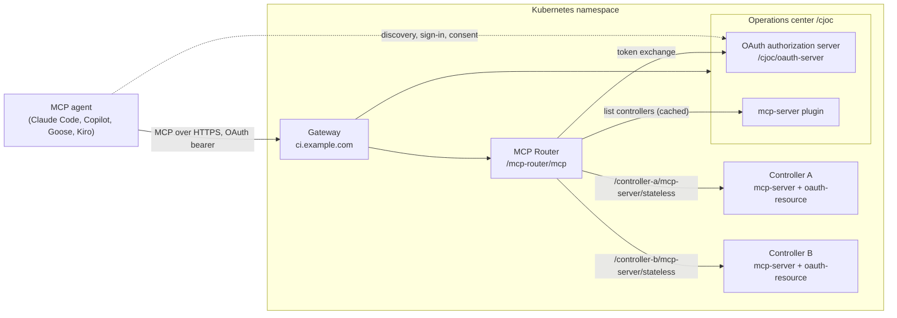
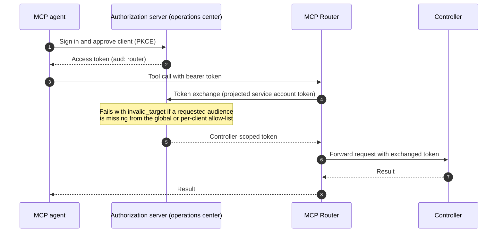

# CloudBees CI MCP Router

How to deploy and configure the CloudBees CI MCP Router with OAuth on Kubernetes, using Helm and CloudBees CI Configuration as Code (CasC) bundles.

- **Scope:** CloudBees CI modern (Kubernetes) with the `cloudbees-core` Helm chart and the Gateway API. Hostnames, controller names and values below are placeholders (`ci.example.com`, `controller-a`).
- **Sources:** product behavior comes from the [CloudBees CI MCP Router documentation](https://docs.cloudbees.com/docs/cloudbees-ci/latest/mcp-router/ci-mcp-router). Values and plugin versions can change between releases, so check the linked page for your version. Anything marked `ASSUMPTION` has not been verified.
- **Secrets:** never commit client secrets, tokens or secrets exported from a running operations center to a bundle repository.

## Contents

1. [Quick start](#quick-start)
2. [Architecture](#architecture)
3. [Prerequisites](#prerequisites)
4. [Helm configuration](#helm-configuration)
5. [CasC configuration](#casc-configuration)
6. [Connecting agents](#connecting-agents)
7. [Rate limiting](#rate-limiting)
8. [Troubleshooting](#troubleshooting)
9. [Further reading](#further-reading)

---

## Quick start

Connect Claude Code to a router that is already deployed (the pre-seeded public client is `ci-mcp-client`):

```bash
claude mcp remove ci-mcp-router
claude mcp add --transport http --client-id ci-mcp-client \
  --callback-port 8123 ci-mcp-router https://ci.example.com/mcp-router/mcp
```

Then run `/mcp`, select `ci-mcp-router` and approve in the browser. Without `--client-id`, Claude Code tries dynamic client registration, which is disabled by default and fails with `403`.

---

## Architecture





Key points:

- The router lists controllers from the operations center, then requests tokens for **all** controller audiences in one exchange. One missing audience fails the whole call.
- Token scope (`MCP_AUTH_UPSTREAM_TOKEN_EXCHANGE_MODE`): `FLEET` (default) issues one token for all controllers; `PER_TARGET` issues one per controller and limits the impact of a compromised controller. Prefer `PER_TARGET` when different teams operate the controllers.
- Upstream mode (`McpRouter.upstreamMode`): `AUTO` exchanges OAuth bearer tokens and forwards any other `Authorization` header unchanged; `OAUTH_ONLY` rejects everything except a bearer token. Use `AUTO` while migrating.
- Each controller succeeds or fails independently, so a controller you cannot access returns its own access-denied result.

---

## Prerequisites

- CloudBees CI `2.541.2.35785` or later.
- MCP Server plugin `0.148.v6b_c057f27738` or later on the controllers you want to reach.
- CloudBees OAuth Authorization Server plugin on the operations center only.
- CloudBees OAuth Resource Server plugin on the operations center and every controller.
- The router image, pinned to a tag or digest you have verified with Cosign (`cosign verify --key https://cdn.cloudbees.com/keyring/cloudbees.pub cloudbees/ci-mcp-router:<my-tag>`). Do not use `latest`.

Docker and manual (non-Helm) deployment are covered in the [upstream installation guide](https://docs.cloudbees.com/docs/cloudbees-ci/latest/mcp-router/ci-mcp-router).

---

## Helm configuration

The `cloudbees-core` chart can deploy the router and configure OAuth in one step. Run `helm diff upgrade` (or `--dry-run=server`) and test in a non-production cluster before you apply changes.

### Values

```yaml
Gateway:
  Enabled: true
  Name: my-gateway
  SectionName: https
  Namespace: cloudbees-ci

OperationsCenter:
  HostName: ci.example.com
  Protocol: https
  # Seeds the authorization and resource server configuration and the discovery endpoints
  OAuthServer:
    Enabled: true
  # Delivers CasC bundles from Git (see CasC configuration)
  CasC:
    Enabled: true
    Retriever:
      Enabled: true
      scmRepo: https://github.com/cb-ci/ci-gateway-api.git
      scmBundlePath: casc/cjoc
      scmBranch: main
      scmPollingInterval: PT1M
      secrets:
        secretName: my-casc-scm-secret   # existing Secret; do not inline credentials
  # Makes GATEWAY_DOMAIN and other variables available to the bundle
  ContainerEnvFrom:
    - configMapRef:
        name: cjoc-casc-envvars

McpRouter:
  enabled: true
  upstreamMode: AUTO
  image:
    tag: my-tag            # pin a verified version
  resources:               # sizing is a starting point; validate under load
    requests: { cpu: 500m, memory: 1Gi }
    limits:   { cpu: 500m, memory: 1Gi }
  extraEnv:
    - name: MCP_ROUTER_OC_CONTROLLERS_CACHE_TTL
      value: "10M"
```

The `cjoc-casc-envvars` ConfigMap supplies the variables the bundle references:

```yaml
apiVersion: v1
kind: ConfigMap
metadata:
  name: cjoc-casc-envvars
data:
  GATEWAY_DOMAIN: ci.example.com
```

### Install or upgrade

```bash
helm repo add cloudbees https://charts.cloudbees.com/public/cloudbees
helm repo update
helm diff upgrade --install cloudbees-core cloudbees/cloudbees-core -n cloudbees-ci -f values-mcp.yaml
helm upgrade --install cloudbees-core cloudbees/cloudbees-core -n cloudbees-ci -f values-mcp.yaml
```

The router is then published at `https://ci.example.com/mcp-router/mcp`. With `--reuse-values` workflows, use `--reset-then-reuse-values`.

### What the chart configures

- The authorization server with the addresses allowed to receive tokens (router and controllers), and the trusted issuer on the operations center and connected controllers.
- The OAuth discovery endpoints.
- A dedicated service account for the router and a projected token (audience `cjoc`) that authenticates token exchange, so no shared secret is needed.

### Tuning values

| Value | Purpose | Default |
| --- | --- | --- |
| `McpRouter.upstreamMode` | `AUTO` or `OAUTH_ONLY`. `OAUTH_ONLY` needs `OperationsCenter.OAuthServer.Enabled: true` and the Resource Server plugin on every controller | `AUTO` |
| `McpRouter.ocInternalUrl` | In-cluster operations center URL, avoids hairpin NAT on EKS/GKE. Computed from `OperationsCenter.Name` and `ContextPath` when empty | `""` |
| `McpRouter.replicas` | Router replicas (in-memory caches only, one is usually enough) | `1` |
| `McpRouter.image.*` | Registry, repository, tag or full `dockerImage` path | chart default |
| `McpRouter.resources` | Requests and limits | `1` CPU / `2Gi` |
| `McpRouter.javaOpts` | Extra JVM options, appended to the built-in ones | unset |
| `McpRouter.extraEnv` | Router environment variables (cache TTL, rate limiting, token exchange mode) | `[]` |
| `McpRouter.privateKeyJwt.enabled` | `NEVER`, `AUTO` or `ALWAYS`: authenticate to the authorization server with an RFC 7523 `private_key_jwt` instead of the projected token | `NEVER` |
| `McpRouter.privateKeyJwt.keySecretName` | Secret with the RSA PEM key (entry `signing-key.pem` by default) | unset |
| `McpRouter.nodeSelector`, `tolerations`, `podSecurityContext`, `containerSecurityContext`, `imagePullSecrets` | Standard Kubernetes scheduling and security settings | unset |
| `OperationsCenter.OAuthServer.RouterAudience` | Router address expected in the `aud` claim. Only for a router running outside the cluster | `http://localhost:9000` |

With `privateKeyJwt.enabled: ALWAYS` and no `keySecretName`, the chart generates a key Secret. Under GitOps or `--dry-run` it cannot look up the existing Secret and may regenerate the key, so create your own Secret instead.

---

## CasC configuration

### Layout and delivery

This repository holds one bundle for the operations center (`casc/cjoc`) and one shared by the controllers (`casc/controller-base`). MCP settings live in `mcp/` files that the bundle descriptor references, so they can be reviewed and reverted independently.

```text
casc/
  cjoc/                         # operations center bundle, id: jenkins
    bundle.yaml
    jenkins.yaml
    credentials.yaml
    rbac.yaml
    plugins.yaml
    variables.yaml
    controllers/                # managed controller items
    mcp/
      mcp-jenkins.yaml          # authorization server + resource server
      mcp-credentials.yaml      # OAuth clients
      mcp-plugins.yaml
      mcp-variables.yaml        # audience variable
  controller-base/              # controller bundle, id: controller
    bundle.yaml
    jenkins.yaml
    plugins.yaml
    casc/                       # CasC plugin settings
    mcp/
      mcp-jenkins.yaml          # resource server only
      mcp-plugins.yaml
      mcp-test-items.yaml       # optional MCP test pipelines, see MCP-TEST-PLAN.md
```

The Helm chart's CasC retriever (see [Helm configuration](#helm-configuration)) polls the Git repository and delivers the operations center bundle from `scmBundlePath` (`casc/cjoc` here). Controller bundles are referenced from the controller items in `casc/cjoc/controllers/`.

### Operations center bundle

`casc/cjoc/bundle.yaml` (abridged to the MCP-relevant parts):

```yaml
apiVersion: "2"
id: "jenkins"
version: "1"
jcasc:
  - "jenkins.yaml"
  - "credentials.yaml"
  - "mcp/mcp-jenkins.yaml"
  - "mcp/mcp-credentials.yaml"
plugins:
  - "plugins.yaml"
  - "mcp/mcp-plugins.yaml"
rbac:
  - "rbac.yaml"
variables:
  - "variables.yaml"
  - "mcp/mcp-variables.yaml"
```

Bump `version` whenever a bundle changes.

`casc/cjoc/mcp/mcp-plugins.yaml`:

```yaml
plugins:
  - id: mcp-server
  - id: cloudbees-oauth-server
  - id: cloudbees-oauth-resource
```

`casc/cjoc/mcp/mcp-jenkins.yaml`:

```yaml
security:
  oauthAuthorizationServer:
    issuer: "https://${GATEWAY_DOMAIN}/cjoc/oauth-server"
    # in-cluster JWKS, avoids hairpin NAT through the gateway
    internalJwksUrl: "http://cjoc/cjoc/oauth-server/jwks"
    # global allow-list: scalar, one audience per line
    allowedAudiences: "${mcp_audiences}"
    accessTokenTtlSeconds: 600
    exchangedTokenTtlSeconds: 300
    # skips the consent prompt for the two seeded clients; set false to require approval
    autoApproveSeededClients: true
    dcrEnabled: false
    enforceTrustedIssuer: false
  oauthResourceServer:
    trustedIssuer: "https://${GATEWAY_DOMAIN}/cjoc/oauth-server"
    filterMode: AUTO
    protectedPaths: "/mcp-server/*"
    clockSkewSeconds: 60
    jwksCacheTtlSeconds: 300
```

- `issuer` and `trustedIssuer` must match exactly, including scheme and path. The `/cjoc` segment is the operations center context path, so adjust it if yours differs.
- `internalJwksUrl` assumes an operations center service named `cjoc`. `ASSUMPTION:` an HTTP in-cluster URL is acceptable here. The upstream troubleshooting page mentions an HTTPS internal address, so confirm for your version.
- `autoApproveSeededClients: true` lets the seeded clients act on a user's identity without explicit approval. Enable it only if your security policy allows that.
- Leave `dcrEnabled: false` on a publicly reachable authorization server.
- `filterMode`: `AUTO` accepts OAuth and existing sign-ins, `OAUTH_ONLY` challenges non-bearer requests to protected paths, `ROUTER_ONLY` accepts only tokens issued through the router.

`casc/cjoc/mcp/mcp-credentials.yaml` declares the two OAuth clients as system credentials:

```yaml
credentials:
  system:
    domainCredentials:
      - credentials:
          # confidential client the router uses for token exchange
          - jenkinsOAuthClient:
              id: "cloudbees-mcp-router"
              description: "CloudBees CI MCP Router"
              scope: SYSTEM
              grantTokenExchange: true
              tokenEndpointAuthMethod: CLIENT_SECRET_BASIC
              # required for token exchange
              audience: "https://${GATEWAY_DOMAIN}/mcp-router"
              # optional per-client restriction: must be a YAML list
              allowedAudiences:
                - "https://${GATEWAY_DOMAIN}/cjoc"
                - "https://${GATEWAY_DOMAIN}/controller-a"
          # public PKCE client for MCP agents (--client-id ci-mcp-client)
          - jenkinsOAuthClient:
              id: "ci-mcp-client"
              description: "CloudBees CI MCP Public Client"
              scope: SYSTEM
              grantAuthorizationCode: true
              grantRefreshToken: true
              pkceRequired: true
              tokenEndpointAuthMethod: NONE
              audience: "https://${GATEWAY_DOMAIN}/mcp-router"
              redirectUrisRaw: |-
                http://127.0.0.1/callback
                http://[::1]/callback
                http://localhost/callback
        domain: {}
```

- Both clients are pre-seeded by the authorization server. Declaring them in CasC keeps their settings in Git.
- No client secret is declared. The router authenticates with its projected service account token.
- If the bundle already has a `credentials.system.domainCredentials` entry in `credentials.yaml`, validate on a test instance that the two fragments merge as you expect.

### Controller bundle

Controllers only validate tokens. They need the resource server, not the authorization server.

`casc/controller-base/mcp/mcp-plugins.yaml`:

```yaml
plugins:
  - id: mcp-server
  - id: cloudbees-oauth-resource
```

`casc/controller-base/mcp/mcp-jenkins.yaml`:

```yaml
security:
  oauthResourceServer:
    jwksUrl: "http://cjoc/cjoc/oauth-server/jwks"   # in-cluster, avoids hairpin NAT
    filterMode: AUTO
    protectedPaths: "/mcp-server/*"
    clockSkewSeconds: 60
    jwksCacheTtlSeconds: 300
```

- Controllers connected to the operations center receive the trusted issuer automatically when none is set, so the bundle leaves `trustedIssuer` out.
- Do not pin `trustedIssuer: "https://${GATEWAY_DOMAIN}/..."` in the controller bundle unless `GATEWAY_DOMAIN` is also defined in the controller's environment. The variable is normally supplied to the operations center only, so on a controller it resolves to an empty host (`https:///cjoc/oauth-server`), every exchanged token is rejected and requests run as anonymous.
- A controller that already stored a bad value may keep it. Set `enforceTrustedIssuer: true` on the authorization server once to overwrite it, then verify with `curl .../controller-a/.well-known/oauth-protected-resource`.
- Install `cloudbees-oauth-server` on the operations center only.
- A controller that uses a different bundle source (for example an external bundle service) gets these settings only if that bundle declares them.

### Variables and audiences

The global and per-client allow-lists use different YAML types, which is the most common source of boot failures:

| Setting | Type | Example |
| --- | --- | --- |
| `security.oauthAuthorizationServer.allowedAudiences` | newline-separated **scalar** | `"${mcp_audiences}"` |
| `jenkinsOAuthClient.allowedAudiences` | YAML **sequence** | `- "https://${GATEWAY_DOMAIN}/cjoc"` |

`casc/cjoc/mcp/mcp-variables.yaml` defines the scalar:

```yaml
variables:
  - mcp_audiences: |
      https://${GATEWAY_DOMAIN}/cjoc
      https://${GATEWAY_DOMAIN}/controller-a
      https://${GATEWAY_DOMAIN}/controller-b
      https://${GATEWAY_DOMAIN}/team-a-controller-c
```

- A variable expands to a single string, so it cannot fill a YAML list. Write the per-client list out explicitly.
- Audience = `https://<GATEWAY_DOMAIN>/<controller URL path>`. For a controller in a folder, the path joins folder and controller with a hyphen (`team-a/controller-c` becomes `team-a-controller-c`). Use the `endpoint` value from `listControllers` as the source of truth.
- Include `cjoc` and every controller on the operations center, including controllers that are currently offline. If a per-client list is set, the global list must contain every entry in it.
- Keep the list in CasC. A bundle reload overwrites edits made in the UI.
- `ASSUMPTION:` how the running operations center treats an empty or absent per-client list was not verified. Check the client in the UI if `invalid_target` reappears.

### Validate and roll out

1. Change the bundle on a branch and bump `version` in `bundle.yaml`.
2. Validate on a non-production operations center or with the CasC bundle validation available in your CloudBees CI version. A bundle that fails to load can stop the operations center from starting.
3. Merge. The retriever picks up the change within `scmPollingInterval`.
4. Apply the bundle or restart the operations center as your CasC settings require, then check [Verify OAuth](#verify-oauth).

If the operations center does not start after a bundle change:

```bash
kubectl get pod cjoc-0 -n cloudbees-ci
kubectl logs cjoc-0 -n cloudbees-ci -c jenkins --previous | grep -n -E 'SEVERE|ConfigurationAsCode|ConfiguratorException'
```

Look for `ConfigurationAsCodeBootFailure` and the file and line in the `ConfiguratorException`. Revert or fix that file in Git. Until the operations center recovers, clients see `HTTP 503` while loading the OAuth metadata.

### Verify OAuth

```bash
# authorization server metadata (issuer path /cjoc/oauth-server)
curl -s https://ci.example.com/.well-known/oauth-authorization-server/cjoc/oauth-server | jq .issuer
# signing keys
curl -s https://ci.example.com/cjoc/oauth-server/jwks | jq '.keys[].kid'
# a controller advertises OAuth
curl -s https://ci.example.com/controller-a/.well-known/oauth-protected-resource
```

Then connect an agent and confirm you are sent through the OAuth sign-in. In an agent session, `whoAmI` shows the identity the router uses per controller and `listControllers` shows topology, state and status.

---

## Connecting agents

Use OAuth. Basic authentication with an API token is also supported, but CloudBees documentation recommends OAuth and describes API tokens as less suitable for new deployments. Generate API tokens on the operations center, not on a controller.

| Agent | Command or guide |
| --- | --- |
| Claude Code | `claude mcp add --transport http --client-id ci-mcp-client ci-mcp-router https://ci.example.com/mcp-router/mcp`, then `/mcp` |
| GitHub Copilot CLI | `copilot mcp add --transport http ci-mcp-router <router-url>`, [guide](https://docs.cloudbees.com/docs/cloudbees-ci/latest/mcp-router/github-copilot) |
| Goose | [guide](https://docs.cloudbees.com/docs/cloudbees-ci/latest/mcp-router/goose) |
| Kiro | `kiro-cli mcp add --name ci-mcp-router --url <router-url>`, [guide](https://docs.cloudbees.com/docs/cloudbees-ci/latest/mcp-router/kiro) |

`<router-url>` is `https://ci.example.com/mcp-router/mcp` for Helm or `http://localhost:9000/mcp` for local Docker. For the API token flow, keep the encoded credential out of shell history and version control.

---

## Rate limiting

Disabled by default. Each caller gets a token bucket and receives `HTTP 429` with `Retry-After` when it is exhausted. Authenticated callers are keyed by a hash of the `Authorization` header, anonymous callers by IP address. Set the variables through `McpRouter.extraEnv`.

| Variable | Default | Description |
| --- | --- | --- |
| `MCP_RATE_LIMIT_ENABLED` | `false` | Master switch |
| `MCP_RATE_LIMIT_PERMITS` | `120` | Requests per caller per window |
| `MCP_RATE_LIMIT_WINDOW` | `1M` | Window (`H`, `M`, `S` suffix) |
| `MCP_RATE_LIMIT_MAX_BUCKETS` | `100000` | Callers tracked at once, least recently seen evicted |
| `MCP_RATE_LIMIT_TRUST_FORWARDED_FOR` | `false` | Trust `X-Forwarded-For` for anonymous callers |

- Observe normal traffic first. About twice the observed peak is a reasonable starting ceiling.
- Enable `MCP_RATE_LIMIT_TRUST_FORWARDED_FOR` only when a trusted proxy sets the header, otherwise callers can forge it.
- Rate limiting protects availability, not access. Keep OAuth enabled.

---

## Troubleshooting

| Symptom | Likely cause | Fix |
| --- | --- | --- |
| `/mcp` fails with `HTTP 503 trying to load OAuth metadata` | Operations center not serving requests, for example crash-looping on a CasC error | Check the `cjoc-0` pod and logs ([Validate and roll out](#validate-and-roll-out)) |
| Operations center log: `Failed to configure 'allowedAudiences': Item isn't a Sequence` | A scalar (such as `"${mcp_audiences}"`) used for a per-client `allowedAudiences` | Use an explicit YAML list ([Variables and audiences](#variables-and-audiences)) |
| `/mcp` fails with `HTTP 504`, router log `token-exchange failed ... invalid_target` | A requested audience, often `.../cjoc`, is missing from the global or per-client list | Add it to `mcp_audiences` and to the client list if one is set, then reload the bundle |
| Tool call returns `audience not in configured allow-list: .../controller-b` | Controller audience missing from the global list | Add all controller audiences, including offline ones |
| Router warns `/cjoc/mcp-server/stateless returned 404`, `listControllers` unavailable | `mcp-server` plugin not installed on the operations center when the router started | Install the plugin, then reconnect with `/mcp` |
| Empty job lists, or unfiltered calls time out | Target controllers offline, deprovisioned or hibernating | Check `listControllers`, start them, or pass controller names |
| `getJobs` on the operations center returns `[]` | The operations center MCP tools cover topology, not job listing | Use the operations center UI or REST API |
| Router logs `Invalid MCP protocol header` (HTTP 400) and continues | Client sends a newer protocol version than the router supports | Harmless fallback, update the router image when a newer one is available |
| `/mcp` fails with `invalid_grant ... audience is not configured for client cloudbees-mcp-router` | The router client has no `audience` set | Add `audience: "https://${GATEWAY_DOMAIN}/mcp-router"` to the `cloudbees-mcp-router` client and reload the bundle |
| Tools return `anonymous is missing the Overall/Read permission` although `/mcp` signed in | The controller rejected the exchanged token and, in `AUTO` mode, treated the request as anonymous. A common cause is an empty issuer: `curl https://ci.example.com/controller-a/.well-known/oauth-protected-resource` shows `"authorization_servers":["https:///cjoc/oauth-server"]`, meaning `${GATEWAY_DOMAIN}` is not defined in the controller's environment | Define the variable for the controllers, or leave `trustedIssuer` out of the controller bundle and let the operations center seed it. Then confirm `whoAmI` returns your user |
| OAuth requests rejected after setup | Issuer, audience or JWKS mismatch | Compare `issuer` and `trustedIssuer` exactly, check each controller's accepted audience, set `internalJwksUrl` if keys are unreachable |

Enable `FINE` logging for `com.cloudbees.jenkins.plugins.oauth.resource` on the instance that rejects the request (it traces `bearer_reject`), then turn it off again:

```yaml
unclassified:
  log:
    recorders:
      - name: oauth-resource
        loggers:
          - name: com.cloudbees.jenkins.plugins.oauth.resource
            level: FINE
```

If an OAuth signing key may be compromised, follow the [signing key incident procedure](https://docs.cloudbees.com/docs/cloudbees-ci/latest/mcp-router/signing-key-incident). A single rotation does not evict the old key.

---

## Further reading

- [Install and deploy](https://docs.cloudbees.com/docs/cloudbees-ci/latest/mcp-router/ci-mcp-router) (Docker, Kubernetes manifests, image verification)
- [OAuth](https://docs.cloudbees.com/docs/cloudbees-ci/latest/mcp-router/oauth) (Helm, manual UI and CasC setup, all tuning options)
- [Authentication overview](https://docs.cloudbees.com/docs/cloudbees-ci/latest/mcp-router/authenticate) and [API token](https://docs.cloudbees.com/docs/cloudbees-ci/latest/mcp-router/token-authentication)
- [Rate limiting](https://docs.cloudbees.com/docs/cloudbees-ci/latest/mcp-router/rate-limiting)
- [Tool reference](https://docs.cloudbees.com/docs/cloudbees-ci/latest/mcp-router/mcp-tool-reference)
- [Troubleshooting](https://docs.cloudbees.com/docs/cloudbees-ci/latest/mcp-router/troubleshooting)
