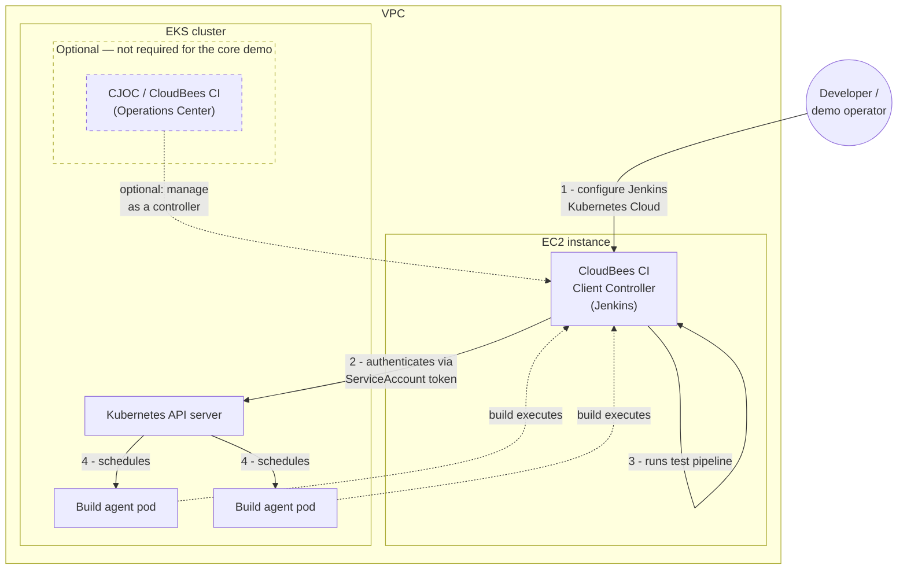

# CloudBees CI — EKS + Remote Client Controller POC

This repository provisions a proof-of-concept environment that demonstrates
CloudBees CI's **Kubernetes Cloud** feature: a Jenkins **Client Controller**
running outside the cluster schedules build agent pods **inside** an Amazon
EKS cluster.

## Purpose

The core scenario this POC demonstrates:

1. An **EKS cluster** is created (VPC, node groups, add-ons).
2. An **EC2 instance** running a CloudBees CI **Client Controller** is
   created in the **same VPC** as the EKS cluster.
3. On that Client Controller, a Jenkins **Kubernetes Cloud** configuration is
   added, pointing at the EKS cluster's API server.
4. A test pipeline run on the Client Controller schedules its **build agent
   pods in the EKS cluster** via that Kubernetes Cloud — proving the
   controller-outside / agents-inside pattern works across the VPC boundary.

Installing **CloudBees CI with an Operations Center (CJOC) into the EKS
cluster itself is optional** — it is useful for a fuller demo (e.g. showing a
managed controller alongside the remote one) but is **not required** to prove
the Kubernetes Cloud / build-pod-scheduling scenario above.

## Architecture



The dashed box is the optional CJOC/CloudBees CI install inside EKS — skip it
for the minimal demo of the Kubernetes Cloud / build-pod-scheduling flow.

For a more detailed, resource-level architecture diagram (ALB, Envoy Gateway,
Route53, ACM, node groups, etc.), see the [eksctl README](eksctl/README.md#architecture).

## Two ways to stand this up

Both options provision the same logical stack — an EKS cluster and an
EC2-hosted Client Controller in the same VPC — and are interchangeable. Pick
one, don't mix them for the same environment.

| Option | Directory | Description |
|---|---|---|
| **eksctl + shell scripts** | [`eksctl/`](eksctl/README.md) | Numbered, sequential shell scripts. Easier to read step-by-step and to run/re-run individual steps by hand. |
| **Terraform** | [`tf/`](tf/README.md) | Three root modules (`01-infra`, `02-platform`, `03-ec2-controller`) applied in order. Declarative, with plan/apply/destroy and state tracking. |

See each directory's README for prerequisites, exact commands, and the full
list of resources created.

## Configuring the Jenkins Kubernetes Cloud (the core of the demo)

Once the EKS cluster and EC2 Client Controller both exist, the remaining
step — wiring the Client Controller to schedule pods in the cluster — is the
same regardless of which option (eksctl or Terraform) provisioned the
infrastructure. That's covered end-to-end in
[README-REMOTE-AGENT.md](README-REMOTE-AGENT.md):

- getting the API server URL and cluster CA certificate
- creating a ServiceAccount, Role, and RoleBinding for the agent pods'
  namespace
- generating a non-expiring token credential
- adding the Kubernetes Cloud in **Manage Jenkins → Clouds → New Cloud →
  Kubernetes** on the Client Controller, and running **Test Connection**

Both provisioning options already create the ServiceAccount/Role/token for
you (`eksctl/08-createServiceAccountforRemoteAgents.sh` or
`tf/02-platform/remote_agents.tf`), so most of that guide is about retrieving
and using the values they produce, not creating new resources by hand.

## Repository layout

```
eks-2026/
├── README.md                  ← this file
├── README-REMOTE-AGENT.md     ← Jenkins Kubernetes Cloud setup (both options)
├── eksctl/                    ← Option A: eksctl + shell scripts
│   └── README.md
└── tf/                        ← Option B: Terraform
    └── README.md
```
