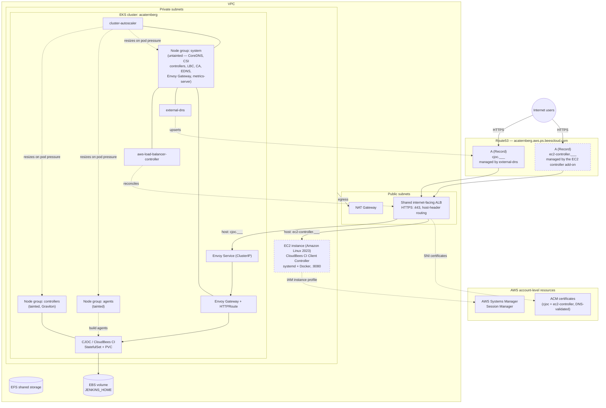

# CloudBees CI on EKS — eksctl Provisioning Scripts

This directory provisions a demo CloudBees CI environment on Amazon EKS: a
cluster with dedicated controller/agent node pools, a shared Application Load
Balancer fronting both an in-cluster Operations Center (CJOC) and an optional
standalone EC2-hosted Client Controller, TLS via ACM, and DNS via Route53.

Scripts are numbered in the order they're meant to be run. Numbers that share
a prefix (e.g. `01-*`, `04-*`) operate on the same resource and are grouped
together below.

## Setup

Every script sources `.env` for its configuration — none of them work
until it exists. Create it from the template before running anything else:

```bash
cp .env-template .env
```

Then edit `.env` and replace every `<USER_ID>` placeholder (in `TAG_CB_USER`
and `CJOC_HOST_NAME`) with your own identifier — it's used to tag every AWS
resource, name the cluster (`CLUSTER_NAME=${TAG_CB_USER}`), and build the
CJOC hostname. Review the rest of the file too (region, chart versions,
storage class) and adjust anything that doesn't match your account.

`.env` is tracked in git in this copy of the repo, so double-check you're
not committing personal values before pushing changes to it.

Finally, source it in every new shell before running any numbered script:

```bash
source .env
```

See [`.env-template`](.env-template) for the full list of variables.

## Execution Sequence

```
00-login.sh
   │
   ▼
01-createCluster.sh                (EKS cluster, VPC, node groups)
   │
   ├──────────────────────────────────────┐
   ▼                                       ▼
02-create-efs-filesystem.sh        03-installClusterAutoscaler.sh
(shared EFS storage — optional)    (Cluster Autoscaler — independent branch,
   │                                run any time after cluster creation)
   ▼
03-installAwsLbController.sh       (AWS Load Balancer Controller)
   │
   ▼
04-installEnvoy.sh                 (Envoy Gateway + shared ALB + ACM cert)
   │
   ▼
05-installCloudBees.sh             (CloudBees CI / CJOC via Helm)
   │
   ▼
06-installExternalDNS.sh           (Route53 record automation for CJOC)
   │
   ▼
07-createEC2WithController.sh      (optional: standalone EC2 Client Controller)
```

[`01-scaleDonwNodePools.sh`](01-scaleDonwNodePools.sh) / [`01-scaleUpNodePools.sh`](01-scaleUpNodePools.sh), [`01-upgradeCluster.sh`](01-upgradeCluster.sh),
[`07-stopEC2Instance.sh`](07-stopEC2Instance.sh) / [`07-startEC2Instance.sh`](07-startEC2Instance.sh),
[`08-createServiceAccountforRemoteAgents.sh`](08-createServiceAccountforRemoteAgents.sh), and every `*delete*.sh` script
are operational — run them any time after the initial sequence, not as part
of it. Teardown runs in the **reverse** order of creation (delete the EC2
add-on and CloudBees CI before Envoy/the ALB, and the ALB before the
cluster) so dependent resources are never orphaned.

### Applying IAM-only config changes to an existing cluster

[`03-installClusterAutoscaler.sh`](03-installClusterAutoscaler.sh) depends on the `cluster-autoscaler` entry
under `iam.serviceAccounts` in [`eksctl-config.yaml.tpl`](eksctl-config.yaml.tpl). If that entry was
added after the cluster already exists, don't re-run [`01-createCluster.sh`](01-createCluster.sh) —
reconcile just the IAM service accounts instead:

```bash
source .env
envsubst < eksctl-config.yaml.tpl > eksctl-config.yaml
eksctl create iamserviceaccount --config-file=eksctl-config.yaml --approve
```

This creates any service account defined in the config that doesn't exist yet
(e.g. `cluster-autoscaler`) and leaves existing ones (e.g.
`aws-load-balancer-controller`) untouched unless you also pass
`--override-existing-serviceaccounts`.

### Reconciling other config changes with `eksctl update cluster`

`eksctl update cluster` is **deprecated** as of the eksctl version pinned for
this environment (`eksctl update cluster --help` prints "DEPRECATED: use
'upgrade cluster' instead") — it only upgrades the control plane's
Kubernetes version and reconciles the CloudFormation stack if resources are
missing, it does **not** apply arbitrary field changes from the config file
the way `terraform apply` would.

```bash
source .env
envsubst < eksctl-config.yaml.tpl > eksctl-config.yaml
eksctl upgrade cluster -f eksctl-config.yaml       # dry run — prints planned changes
eksctl upgrade cluster -f eksctl-config.yaml --approve   # actually apply them
```

For an actual Kubernetes version bump, use
[`01-upgradeCluster.sh`](01-upgradeCluster.sh) instead — it wraps `eksctl
upgrade cluster` plus the EKS-managed add-on and node group upgrade steps
this command doesn't perform. For most other day-2 config drift (IAM service
accounts, node group scaling, add-on config), use the targeted commands in
[Applying IAM-only config changes to an existing cluster](#applying-iam-only-config-changes-to-an-existing-cluster)
above or the relevant numbered script instead.

## Node Groups & Workload Isolation

[`eksctl-config.yaml.tpl`](eksctl-config.yaml.tpl) provisions three managed node groups:

| Node group | Taint | Label | Purpose |
| --- | --- | --- | --- |
| `controllers` | `workload=controller:NoSchedule` | `workload: controller` | CJOC and CloudBees CI Managed Controllers only. Graviton (ARM64), sized for steady-state control-plane-style workloads. |
| `agents` | `workload=agent:NoSchedule` | `workload: agent` | Ephemeral Jenkins Pipeline build pods only. x86_64. |
| `system` | *(none — deliberately untainted)* | `workload: system` | Cluster add-ons that don't carry a `workload`-specific toleration: CoreDNS, EBS/EFS CSI controllers, Envoy Gateway, external-dns, aws-load-balancer-controller, cluster-autoscaler, metrics-server. |

**Why `system` exists:** `controllers` and `agents` are both tainted so CI
workloads land only where intended — build pods can never land on
controller nodes and vice versa. But once *every* node group carries a
taint, any pod without a matching toleration has nowhere left to schedule,
including cluster-critical Deployments that ship with no custom tolerations
by default (CoreDNS, CSI driver controllers, the LB controller, the
autoscaler itself, etc.). Patching tolerations onto each of those
individually means touching a different mechanism per component — EKS addon
`configurationValues`, Helm chart values, raw manifests — and redoing it
every time a new add-on is installed. `system` sidesteps that: as the only
untainted pool, anything without a `workload` toleration schedules there
automatically, with zero changes to the add-on's own spec.

Workloads that need to land specifically on `controllers` or `agents` must
carry **both**:

- a **toleration** matching that pool's taint (permission to land there), and
- a **`nodeSelector`** for that pool's `workload` label (the actual
  requirement to land there — see the `nodeAffinity` caveat below).

A toleration alone only grants permission, it doesn't force placement — a
pod with the right toleration but no matching selector can still land on
`system` (or any other untainted node) instead, since nothing requires
otherwise. This is a live gotcha, not theoretical: see
[`controller-statefullset-patch.yaml`](controller-statefullset-patch.yaml) below.

### [`controller-statefullset-patch.yaml`](controller-statefullset-patch.yaml)

Raw StatefulSet YAML merge patch intended for CJOC's **Kubernetes Master
Provisioning → Advanced** config, so that dynamically-provisioned Managed
Controller pods land on the `controllers` pool. **This file is not
referenced by any script** — it only takes effect if its contents are
pasted into that CJOC config field (or wired in via CasC/groovy) by hand.
Confirm it's actually applied by inspecting a live controller's pod spec
(`kubectl get pod <controller>-0 -o jsonpath='{.spec.nodeSelector}{"\n"}{.spec.tolerations}'`),
not by assuming the file's existence means it's in effect.

Confirmed live behavior: CJOC's StatefulSet merge does **not** deep-merge
`spec.affinity`. The base template it generates for every Managed Controller
already sets `affinity.nodeAffinity` (a `kubernetes.io/os: linux` check), so
merging in a patch that adds a second `matchExpressions` entry under that
same key silently drops the addition — and the patch's whole
`podAntiAffinity` block never applied either. `tolerations`, by contrast,
isn't set by the base template at all, so it merges in with no collision.
**This is why the patch sets both `tolerations` and a plain `nodeSelector`**
— `nodeSelector` is a distinct top-level field the base template never
populates, so it isn't subject to the same merge collision, and is what
actually forces controllers onto the `controllers` pool today. Don't rely on
the `nodeAffinity`/`podAntiAffinity` blocks in this file taking effect until
CJOC's merge behavior is confirmed otherwise.

### [`Jenkinsfile`](Jenkinsfile)

Sample pipeline in this directory. Its inline Kubernetes pod agent carries a
`nodeSelector: {workload: agent}` and a matching toleration for
`workload=agent:NoSchedule` — required now that the `agents` pool is
tainted. Any other pipeline or Kubernetes-plugin `PodTemplate` that
provisions build agents on this cluster needs the same two additions, or its
agent pods will stay `Pending` indefinitely.

## Scripts Reference

| Order | Script | Purpose |
| --- | --- | --- |
| 00 | [`00-login.sh`](00-login.sh) | Authenticates the AWS CLI via `aws sso login`. Run this first in any new shell/session. |
| 01 | [`01-createCluster.sh`](01-createCluster.sh) | Renders [`eksctl-config.yaml.tpl`](eksctl-config.yaml.tpl) and creates the EKS cluster, VPC, managed node groups (`controllers` and `agents`, both tainted for workload isolation; `system`, untainted, for cluster add-ons — see [Node Groups & Workload Isolation](#node-groups--workload-isolation)), OIDC/IRSA and Pod Identity, and the EBS/EFS CSI + Pod Identity Agent add-ons. Migrates to EKS Pod Identity and writes kubeconfig. |
| 01 | [`01-scaleDonwNodePools.sh`](01-scaleDonwNodePools.sh) | Scales every managed node group to 0 to park the environment (saves EC2 cost only — control plane, NAT, ALB, EBS/EFS keep billing). Saves current sizes to [`.nodepool-scale-state.json`](.nodepool-scale-state.json). |
| 01 | [`01-scaleUpNodePools.sh`](01-scaleUpNodePools.sh) | Restores node groups to the sizes recorded by the scale-down script (or explicit `--nodes*` flags / config defaults if that state file is missing). |
| 01 | [`01-deleteCluster.sh`](01-deleteCluster.sh) | Deletes the entire EKS cluster and its eksctl-managed CloudFormation stacks (VPC, subnets, node groups, IAM). Last step of a full teardown. |
| 01 | [`01-upgradeCluster.sh`](01-upgradeCluster.sh) | Upgrades the cluster one Kubernetes minor version at a time: control plane (`eksctl upgrade cluster`), EKS-managed add-ons (`eksctl update addon`), then managed node groups (`eksctl upgrade nodegroup`). Refreshes kubeconfig and bumps the `version:` field in [`eksctl-config.yaml.tpl`](eksctl-config.yaml.tpl) to match. Defaults to current+1 minor version; override with `--version`. |
| 02 | [`02-create-efs-filesystem.sh`](02-create-efs-filesystem.sh) | Creates an EFS file system + mount target + security group for shared storage, verifies the `aws-efs-csi-driver` IAM role, deploys a StorageClass, and runs an end-to-end test PVC/Pod. |
| 02 | [`02-delete-efs-filesystem.sh`](02-delete-efs-filesystem.sh) | Removes everything the EFS create script made: test namespace, StorageClass, fallback IAM role, mount targets, file system, and security group. |
| 03 | [`03-installAwsLbController.sh`](03-installAwsLbController.sh) | Installs the AWS Load Balancer Controller via Helm using the IRSA ServiceAccount eksctl already created, applies its CRDs, and verifies public subnets carry the `kubernetes.io/role/elb=1` tag the controller needs to place an ALB. |
| 03 | [`03-installClusterAutoscaler.sh`](03-installClusterAutoscaler.sh) | Installs Kubernetes Cluster Autoscaler via Helm using the IRSA ServiceAccount eksctl created (`wellKnownPolicies.autoScaler`), matches the image tag to the cluster's live Kubernetes minor version, and verifies both node groups' ASGs are tagged for auto-discovery (automatic since `minSize != maxSize` on `controllers`/`agents`). Also grants supplemental read-only RBAC on the `resource.k8s.io` API group (Dynamic Resource Allocation objects), which newer autoscaler builds watch unconditionally but the Helm chart's bundled ClusterRole doesn't grant. Independent of the ALB/Envoy chain — run any time after [`01-createCluster.sh`](01-createCluster.sh). |
| 04 | [`04-installEnvoy.sh`](04-installEnvoy.sh) | Installs Envoy Gateway, requests/validates the ACM certificate for `CJOC_HOST_NAME` (with automated Route53 DNS validation), and creates the Gateway/GatewayClass/HTTPRoute plumbing plus the `cjoc-alb` Ingress that provisions the **shared internet-facing ALB**. |
| 04 | [`04-deleteEnvoy.sh`](04-deleteEnvoy.sh) | Tears down the Ingress (deprovisioning the ALB), Gateway API resources, and the Envoy Gateway Helm release. Leaves the CloudBees namespace, CRDs, and ACM certificate in place unless `--delete-crds` / `--delete-cert` are passed. |
| 05 | [`05-installCloudBees.sh`](05-installCloudBees.sh) | Installs CloudBees CI (Operations Center / CJOC) via the `cloudbees/cloudbees-core` Helm chart, wired to the Gateway from step 04, and waits for the Gateway to get an address. |
| 05 | [`05-deleteCloudBees.sh`](05-deleteCloudBees.sh) | Uninstalls the CloudBees CI Helm release and associated resources. |
| 06 | [`06-installExternalDNS.sh`](06-installExternalDNS.sh) | Installs `external-dns` (via EKS Pod Identity) scoped to a least-privilege, hosted-zone-specific IAM policy, so Route53 A records for `CJOC_HOST_NAME` are created/kept in sync automatically from the Ingress. |
| 07 | [`07-createEC2WithController.sh`](07-createEC2WithController.sh) | **Optional add-on.** Provisions a standalone Amazon Linux 2023 EC2 instance (Java 21 + Docker + systemd-managed CloudBees CI Client Controller container) and wires it into the *same shared ALB* from step 04 via a new host-header listener rule, its own ACM certificate (SNI), a dedicated target group/security group/IAM instance profile, and a Route53 alias record — without creating a second ALB. Also adds a scoped 443 rule to the EKS cluster's own security group so this instance can reach the Kubernetes API server (needed because `clusterEndpoints.privateAccess: true` routes in-VPC clients through that security group, not the public endpoint). |
| 07 | [`07-deleteEC2WithController.sh`](07-deleteEC2WithController.sh) | Tears down everything the EC2 create script added (listener rule, target group, instance, the cluster-security-group's 443 rule, security group, IAM role/profile, Route53 record; ACM cert opt-in via `--delete-cert`) while explicitly leaving the VPC, EKS cluster, and shared ALB/listener/default certificate untouched. |
| 07 | [`07-stopEC2Instance.sh`](07-stopEC2Instance.sh) | Stops (does not terminate) the EC2 Client Controller instance to park it and save EC2 compute cost, leaving its security group, IAM role, target group, listener rule, ACM cert, Route53 record, and EBS volume untouched. Waits for `stopped` by default (`--no-wait`, `--yes`). |
| 07 | [`07-startEC2Instance.sh`](07-startEC2Instance.sh) | Starts a previously stopped EC2 Client Controller instance back up so the target group reports healthy again. Waits for `running` by default (`--no-wait`, `--yes`). |
| 08 | [`08-createServiceAccountforRemoteAgents.sh`](08-createServiceAccountforRemoteAgents.sh) | Creates a `jenkins-agent` ServiceAccount, Role, and RoleBinding in the `cbci-builds` namespace (get/list/watch/create/delete/update/patch on pods, pods/log, pods/exec, events, and PVCs), plus a non-expiring legacy-style Secret token, and prints the decoded token — used to configure a Jenkins Kubernetes Cloud (e.g. from a remote/standalone Controller) so it can provision agent pods in this cluster. |

## Architecture



Dashed-border nodes (`EC2`, `R53_EC2`) are the optional add-on from step 07 —
everything else is created by the core 01–06 sequence.
