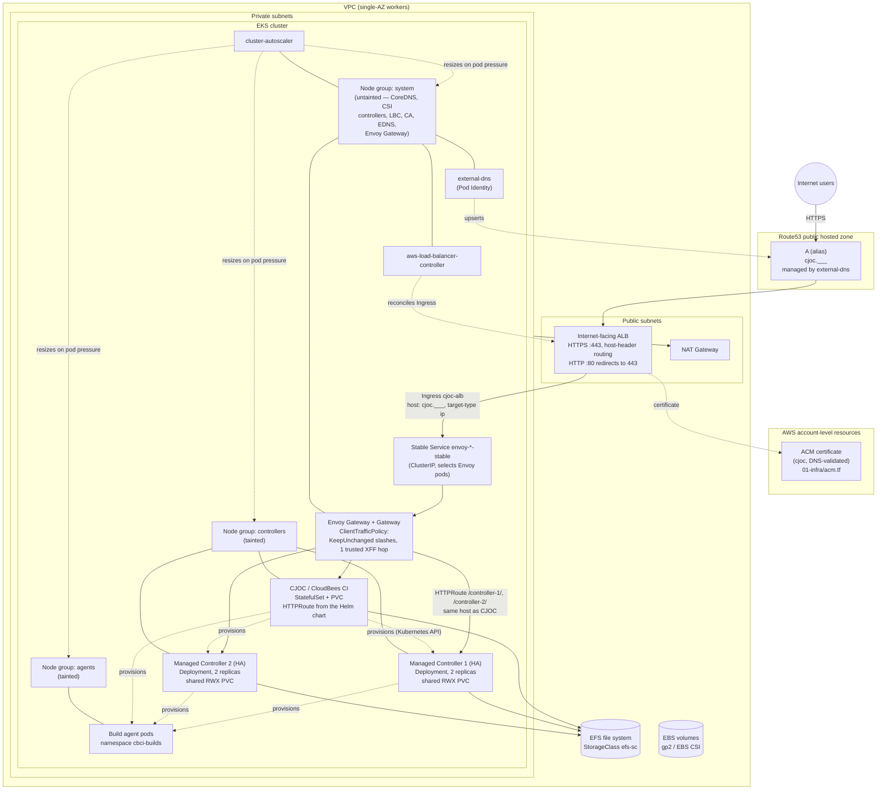
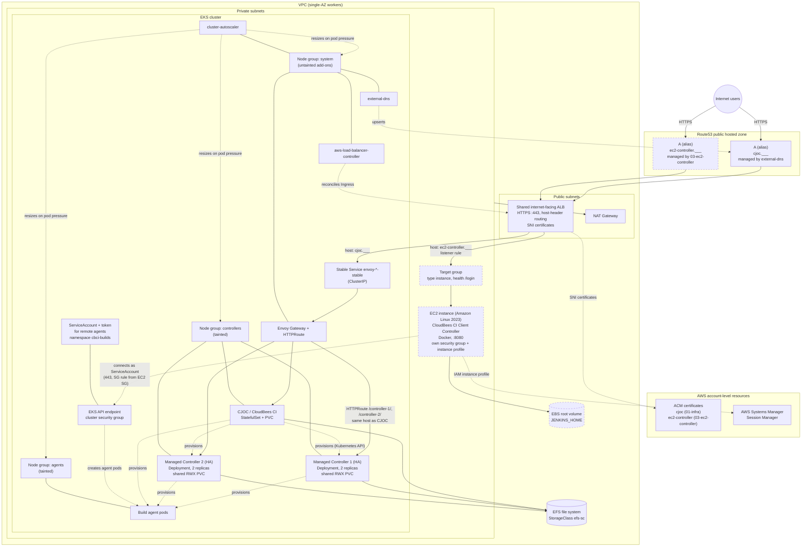

# Architecture diagrams (Terraform)

Two views of what the Terraform stacks in this directory build. Layout follows
the diagram in [`../eksctl/README.md`](../eksctl/README.md).

| Stack | Creates |
| --- | --- |
| [`01-infra`](01-infra) | VPC, EKS cluster + node groups, EKS add-ons, IRSA / Pod Identity roles, EFS, CJOC ACM certificate |
| [`02-platform`](02-platform) | Envoy Gateway, Gateway/ClientTrafficPolicy, ALB Ingress, AWS LB Controller, external-dns, cluster-autoscaler, EFS StorageClass, CloudBees CI Helm release, remote-agent ServiceAccount |
| [`03-ec2-controller`](03-ec2-controller) | *Optional.* EC2 Client Controller on the shared ALB |

## 1. CloudBees CI on EKS only (`01-infra` + `02-platform`)

TLS terminates at the ALB; Envoy listens on plain HTTP behind it, but the
Operations Center is configured with `Protocol: https` so generated URLs stay
correct.

The two Managed Controllers are created from the Operations Center UI, not by
Terraform. Each runs in High Availability mode: a Deployment with two replicas
that share one ReadWriteMany PVC on `efs-sc` (EFS), which is why a ReadWriteOnce
class such as `gp2` cannot be used for them. Both are reached on the CJOC host
under their own path through Envoy. The node names and paths above are
placeholders, and the controllers must be scheduled onto the `controllers` node
group (see `controller-statefullset-patch.yaml` in the eksctl directory; note it
patches a StatefulSet, so an equivalent patch for HA Deployments is needed).

## 2. With the optional EC2 Client Controller (`03-ec2-controller`)

Same core as above. Dashed nodes are added by `03-ec2-controller`; it reuses
the existing ALB and HTTPS listener rather than creating a second load balancer.

The EC2 stack looks up the ALB by its `ingress.k8s.aws/stack` tag, so
`02-platform` must be applied first. The EC2 instance's security group accepts
traffic only from the ALB's security group (SSH is limited to the VPC CIDR
unless `ssh_cidr` is set), and `03-ec2-controller` adds a 443 ingress rule on
the EKS cluster security group so the controller can reach the Kubernetes API.
