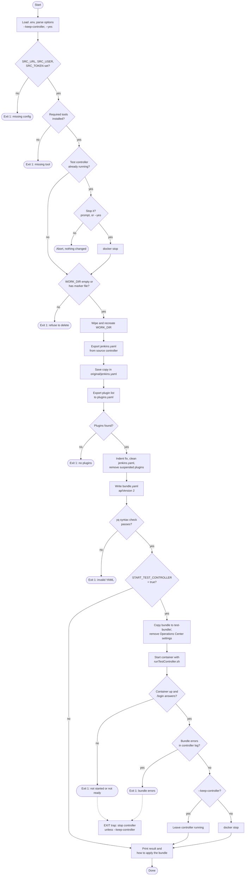
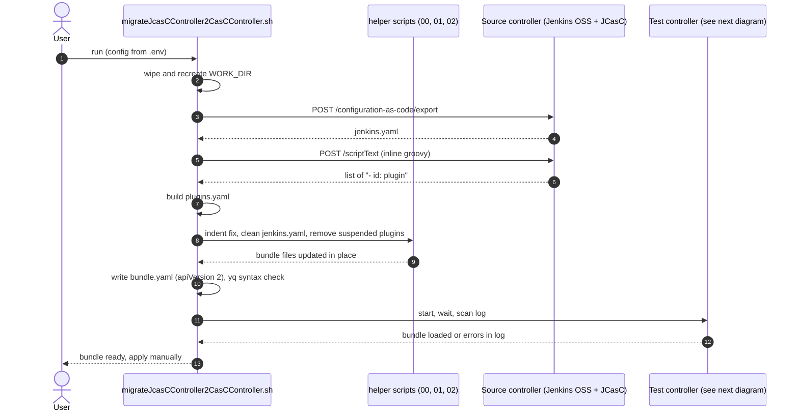
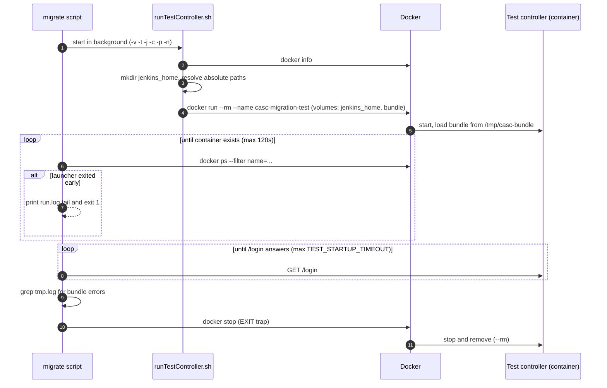
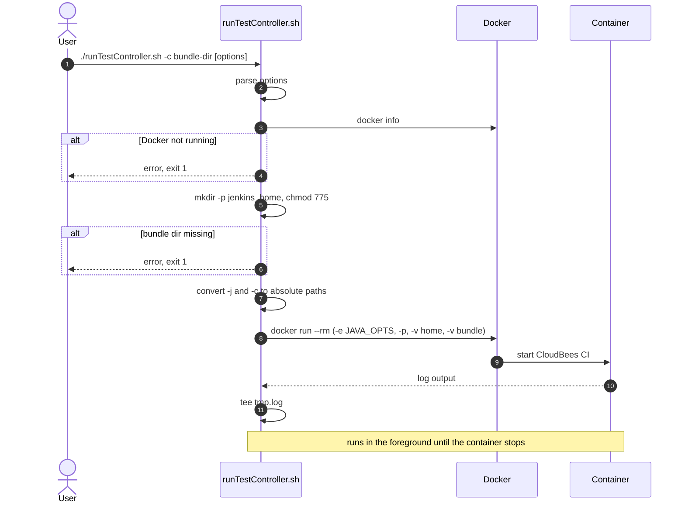

# Migrating a JCasC controller to a CloudBees CasC bundle

Two scripts in this directory:

| Script | Purpose |
| --- | --- |
| `migrateJcasCController2CasCController.sh` | Exports the config of a Jenkins OSS controller (JCasC plugin) and builds a CloudBees CasC bundle (`bundle.yaml`, `jenkins.yaml`, `plugins.yaml`). Checks that a test controller loads it. |
| `runTestController.sh` | Starts a CloudBees CI controller in Docker with a CasC bundle mounted. Used by the migration script, also usable on its own. |

**Terms**

- **Source controller**: the old Jenkins OSS controller with the JCasC plugin.
- **Target controller**: the new CloudBees CI controller that loads the bundle.

## Prerequisites

- `curl`, `yq` (v4, the repo README asks for 4.30)
- `docker` (only when a test controller is started)
- A user and API token on the source controller that may call `/configuration-as-code/export` and `/scriptText` (administer permission)

## Out of Scope

- Credentials: This script does not migrate any credentials. They will be migrated separately. See <https://github.com/cb-ci/ci-credentials-migration>
- Jobs: This script does not migrate any jobs. They will be migrated separately. (f.e. using rsync or scp)

## Configuration

The migration script reads `scripts/casc/.env` (git-ignored) and falls back to environment variables. Values in `.env` override the environment. Never commit tokens.

| Variable | Default | Meaning |
| --- | --- | --- |
| `SRC_URL`, `SRC_USER`, `SRC_TOKEN` | required | Source controller URL, user, API token |
| `START_TEST_CONTROLLER` | `true` | Start a local test controller for the bundle check |
| `TEST_CI_VERSION` | `latest` | Image tag of `cloudbees/cloudbees-core-<type>` |
| `TEST_CI_TYPE` | `mm` | Image type (`mm` = managed controller) |
| `TEST_PORT` | `9080` | Host port mapped to 8080 |
| `TEST_CONTAINER_NAME` | `casc-migration-test` | Docker container name, used to find and stop it |
| `TEST_STARTUP_TIMEOUT` | `300` | Seconds to wait until the test controller answers |
| `KEEP_TEST_CONTROLLER` | `false` | Keep the test controller running after the script (same as `--keep-controller`) |
| `BUNDLE_ID` | `casc-controller` | `id` written to `bundle.yaml` |
| `WORK_DIR` | `${TMPDIR:-/tmp}/casc-migration-workdir` | Work dir, wiped at the start of every run |

Example `.env` (placeholders only):

```bash
SRC_URL=https://jenkins.example.com/jcasc-controller
SRC_USER=your-user
SRC_TOKEN=your-api-token
TEST_CI_VERSION=latest
```

## Usage

```bash
cd scripts/casc
cp .env.template .env      # then edit
./migrateJcasCController2CasCController.sh [options]
```

| Option | Meaning |
| --- | --- |
| `--keep-controller` | Leave the test controller running after the script. Default: it is stopped. Overrides `KEEP_TEST_CONTROLLER` from `.env` |
| `-y`, `--yes` | Do not ask before stopping an already running test controller. Required when there is no terminal |
| `-h`, `--help` | Show the options |

Result in `$WORK_DIR`:

```
bundle/bundle.yaml    apiVersion "2", id, version, jcasc + plugins references
bundle/jenkins.yaml   exported and cleaned JCasC config
original/jenkins.yaml unchanged export from the source controller, for diffing against bundle/jenkins.yaml
bundle/plugins.yaml   installed plugins (suspended ones removed)
test-bundle/          copy of bundle/ without Operations Center settings, mounted into the test controller
test-controller/      run.log, tmp.log (controller log), jenkins_home/
```

## What the migration script does

| Step | Action |
| --- | --- |
| 0 | Wipe and recreate `WORK_DIR`; copy the helper scripts and write a helper `.env` pointing at the work dir |
| 1 | `POST <SRC_URL>/configuration-as-code/export` writes `jenkins.yaml` |
| 2 | Run an inline groovy script via `<SRC_URL>/scriptText`; it prints `- id: <plugin>` per installed plugin |
| 3 | The groovy output is already the `plugins.yaml` content (`plugins:` list); the script checks it contains plugins |
| 4/5 | Run `scripts/00-indent2Yaml.sh`, `01-jenkinsYamlClean.sh` (removes the paths listed in `transform.yaml`), `02-pluginsRemoveSuspended.sh` |
| 6/7 | Write `bundle.yaml` directly as `apiVersion: "2"` |
| 8 | Check the YAML with `yq`, start the test controller, wait for it and scan its log for bundle errors |
| 9 | Not automated. The script prints how to apply the bundle |

### Flow



Failures after the container has started also run the EXIT trap, which stops the controller unless `--keep-controller` is set (dotted arrows).

### Sequence



## Test controller and bundle check

If `START_TEST_CONTROLLER=true` (the default), the script starts a throwaway controller with `runTestController.sh`.

**Before the work dir is wiped**, the script checks for a running container named `TEST_CONTAINER_NAME`, for example one kept alive by an earlier `--keep-controller` run. If it finds one, it asks `Stop it and delete its Jenkins home for a fresh start? [y/N]`.

- `n` (or Enter): the script aborts and changes nothing.
- `y`, or `--yes`: it stops the container. The old Jenkins home lives inside `WORK_DIR` (`test-controller/jenkins_home`) and is deleted by the work dir wipe that follows.
- No terminal and no `--yes`: the script exits with an error.

**Operations Center-free copy.** The test controller has no Operations Center, so the script copies `bundle/` to `test-bundle/` and runs `scripts/001-jenkinsYamlDisableOC.sh` on the copy. That replaces `securityRealm` with a local `admin` realm (from `patches/jenkins_securityrealm.yaml`), removes `authorizationStrategy` and removes the OC agent cloud entry. The real `bundle/` keeps its OC settings. The test controller mounts `test-bundle/`, and the port is bound to `127.0.0.1` only.

Then the script:

1. Waits for the named container, and fails early if `runTestController.sh` exits first (the last 20 lines of `run.log` are printed).
2. Waits until `<url>/login` answers 200, 401 or 403, up to `TEST_STARTUP_TIMEOUT` seconds.
3. Greps the controller log for bundle errors (`SEVERE` lines mentioning casc/bundle, or "Failed to load/apply ... bundle"). The patterns are a guess at the log wording (*unverified*).
4. On exit (EXIT trap, including failure): stops the container, or with `--keep-controller` leaves it running and prints the URL and `docker stop <name>`.



## runTestController.sh

Starts `cloudbees/cloudbees-core-<type>:<version>` in the foreground and writes the log to `tmp.log` in the current directory.

| Option | Default | Meaning |
| --- | --- | --- |
| `-v, --version` | `latest` | Image tag |
| `-t, --type` | `mm` | Image type |
| `-j, --jenkins-home PATH` | `$PWD/jenkins_home-controller-base` | Mounted at `/var/jenkins_home` (created if missing) |
| `-c, --casc-bundle PATH` | `$PWD/controller-base` | Mounted at `/tmp/casc-bundle`; must exist |
| `-p, --port MAPPING` | `9080:8080` | Docker port mapping |
| `-n, --name NAME` | docker generated | Container name |

Relative paths for `-j` and `-c` are converted to absolute paths, because Docker would otherwise read them as volume names.

Notes:

- The controller loads the bundle through `-Dcore.casc.config.bundle=/tmp/casc-bundle`. HA is disabled (`-Dcom.cloudbees.jenkins.ha=false`) and the update-center signature check is off (`noSignatureCheck=true`), so use it for tests only.
- The container uses `--rm`, so it is removed when stopped.
- The first run pulls the image, which can take a while.



## Known limitations and things to review

- **Apply is manual.** The script only builds the bundle and checks that a test controller loads it. Copy the bundle to the target's bundle location or upload it via the UI.
- **Review `jenkins.yaml` before use.** The JCasC export can contain secret references or environment-specific values. Only the paths in `transform.yaml` are removed.
- **Plugin list is names only.** Versions are not pinned in `plugins.yaml`.
- **Unverified assumption:** the log patterns used to detect bundle errors. Check them on the first run and adjust.
- **No API validation.** The `casc-bundle-validate` call was removed. The only checks are the `yq` syntax check, a successful startup and the log scan.
- **The test controller loads the OC-free copy**, not your real bundle. Startup success shows the rest of the bundle loads, but it says nothing about the OC settings.
- **Startup failures seen so far:** an empty `advisor: {}` section (now removed through `transform.yaml`) and user properties like `apiToken` in the shared security realm patch (rejected by newer controllers; the patch file no longer contains them). Other empty `{}` sections may be rejected the same way.
- **Cleanup.** The work dir is deleted at the start of each run, only if it is empty or carries the `.casc-migration-workdir` marker. On Linux, root-owned files from the container's jenkins_home may block the deletion.
- **A running container** named `casc-migration-test` is handled by the prompt described above. If `docker run` still fails with a name conflict, run `docker rm -f casc-migration-test`.
